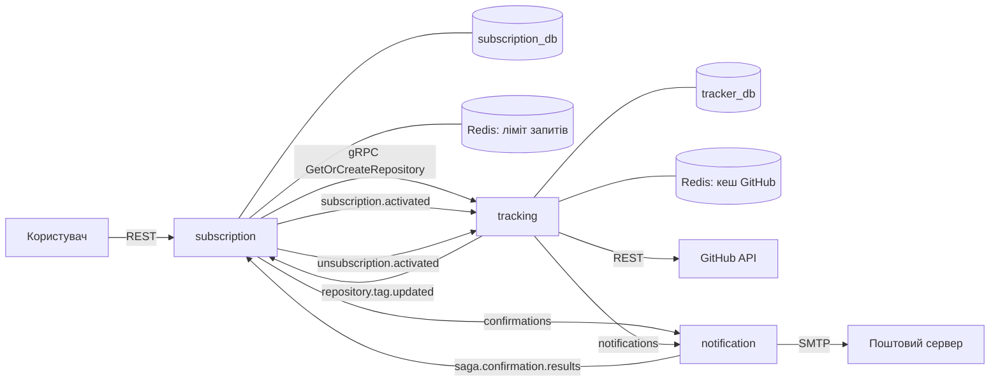

# Компоненти, взаємодія та структура

Частина специфікації; короткий огляд і критерії прийняття — у [spec.md](../../spec.md).

## Компоненти

Система складається з трьох сервісів і спільного модуля. Рішення про поділ — [ADR-0001](../adr/0001-split-into-three-services.md), про розкладку коду — [ADR-0003](../adr/0003-go-workspace-with-a-module-per-service.md).

### subscription

| Поле | Зміст |
|---|---|
| Відповідальність | Керує користувачами та підписками від запиту до підтвердження чи відписки |
| Володіє даними | `subscription_db`: `users`, `repositories`, `subscriptions`, `subscription_sagas`, `outbox_messages` |
| Надає | REST: `POST /api/v1/subscribe`, `GET /api/v1/subscriptions`, `GET /api/v1/confirm/:token`, `GET /api/v1/unsubscribe/:token`, `GET /health`, `GET /version`, веб-сторінка `/`. gRPC `SubscriptionService`: `Subscribe`, `Unsubscribe`, `ListSubscriptions`. Публікує: `SendConfirmationCommand`, `SubscriptionActivatedEvent`, `UnsubscriptionActivatedEvent` |
| Потребує | gRPC `TrackingService.GetOrCreateRepository`; споживає `ConfirmationResultEvent`, `TagUpdatedEvent`; PostgreSQL; RabbitMQ; Redis для обмеження частоти запитів |
| Чому окремо | Єдиний сервіс, що приймає запити від людей. Навантаження мале й нерівномірне, а вимога одна — швидко відповісти. Він не має зупинятися, коли GitHub або пошта недоступні |

### tracking

| Поле | Зміст |
|---|---|
| Відповідальність | Знає, який реліз кожного репозиторію останній, і виявляє появу нового |
| Володіє даними | `tracker_db`: `repositories`, `subscriptions`, `outbox_messages` |
| Надає | gRPC `TrackingService`: `GetOrCreateRepository`. Публікує: `SendNotificationCommand`, `TagUpdatedEvent`. `GET /health`, `GET /version` |
| Потребує | GitHub REST API; споживає `SubscriptionActivatedEvent`, `UnsubscriptionActivatedEvent`; PostgreSQL; RabbitMQ; Redis для кешу відповідей GitHub |
| Чому окремо | Створює постійне навантаження, що залежить від кількості репозиторіїв, а не користувачів, і впирається в ліміт запитів GitHub. Єдиний сервіс, що звертається до GitHub: збій чи обмеження GitHub не зачіпає підтвердження, перегляд і відписку. Нова підписка від нього залежить і відхиляється з `503` (SC-1) |

### notification

> **Відкладено до Завдання 3.** Сервіс, черги й ретранслятор не реалізуються в цьому завданні; вони лишаються в специфікації як заплановані.

| Поле | Зміст |
|---|---|
| Відповідальність | Надсилає листи за командами з черги |
| Володіє даними | немає |
| Надає | Публікує: `ConfirmationResultEvent`. `GET /health`, `GET /version` |
| Потребує | споживає `SendConfirmationCommand`, `SendNotificationCommand`; SMTP; RabbitMQ |
| Чому окремо | Навантаження приходить сплесками: реліз популярного репозиторію породжує лист на кожного підписника. Черга згладжує сплеск, а повільний чи недоступний поштовий сервер не затримує ні сканер, ні API. Сервіс не має стану, тож його можна запускати в кількох екземплярах |

### shared

| Поле | Зміст |
|---|---|
| Відповідальність | Код, однаковий для всіх сервісів |
| Володіє даними | немає |
| Надає | `contracts` — структури повідомлень і назви черг; `ctxlog` — логер і `request_id` у контексті; `config` — читання змінних середовища; `buildinfo` — хеш коміту, вшитий під час збірки; `domain/model` — запис outbox; `infrastructure/probe` — обробник `/health` і `/version`; `infrastructure/httpserver` — HTTP-сервер із коректною зупинкою |
| Потребує | нічого з сервісів |
| Чому окремо | Контракт повідомлення мають однаково розуміти видавець і споживач, тому він існує в одному примірнику. Бізнес-логіки тут немає: правило, потрібне лише одному сервісу, лишається в цьому сервісі |

Рядок «Надає» перелічує лише пакети, які є в `shared/`. Новий пакет — підключення до бази чи брокера, метрики, згенерований gRPC-код — додається сюди тим самим комітом, що й код, і лише якщо він потрібен щонайменше двом сервісам.

### Внутрішні шари сервісу

Усі сервіси мають однакову будову. Залежності спрямовані лише до `domain`.

| Шар | Тека | Є в сервісах | Може залежати від |
|---|---|---|---|
| Модель | `internal/domain/model` | усі | — |
| Інтерфейси репозиторіїв | `internal/domain/repository` | subscription, tracking | модель |
| Інтерфейси зовнішніх служб | `internal/domain/service` | tracking, notification | модель |
| Інтерфейси сценаріїв | `internal/domain/usecase` | усі | модель |
| Сценарії | `internal/usecase` | усі | модель, усі інтерфейси, сага |
| Сага | `internal/saga` | subscription | модель, інтерфейси репозиторіїв |
| Репозиторії | `internal/repository` | subscription, tracking | модель, інтерфейси репозиторіїв |
| Інфраструктура | `internal/infrastructure` | усі | модель, інтерфейси |
| Транспорт | `internal/transport` | усі | модель, інтерфейси сценаріїв |
| Точка входу | `cmd` | усі | усе |

З `shared` будь-який шар може використовувати лише `ctxlog` і `contracts`. `shared/domain` додатково доступний інтерфейсам репозиторіїв. Решта `shared` (`config`, `buildinfo`, `infrastructure`) доступна тільки репозиторіям, інфраструктурі, транспорту та `cmd`.

Транспорт викликає сценарій і ніколи не звертається до репозиторію, навіть через власний інтерфейс. Зокрема, споживачі подій у `tracking` викликають `SubscriberUseCase`, а правило «репозиторій без підписників більше не відстежується» належить сценарію.

## Взаємодія

Стрілки з назвами черг проходять через RabbitMQ.

У Завданні 2 діють зв'язки 1, 2 і 9–11. Зв'язки 3–8 і 12 потребують брокера, `notification` і ретранслятора, тому відкладені до Завдання 3.

| № | Звідки | Куди | Спосіб | Контракт | Гарантія | Що буде при збої |
|---|---|---|---|---|---|---|
| 1 | Користувач | subscription | REST | шляхи з розділу «Компоненти» | 25 с на підписку, 3 с на решту | відповідь з кодом помилки |
| 2 | subscription | tracking | gRPC | `TrackingService.GetOrCreateRepository` | у межах часу запиту підписки | `NotFound` стає `404`; `FailedPrecondition` стає `422`; `Unavailable`, `ResourceExhausted` і `DeadlineExceeded` стають `503`; підписка не створюється |
| 3 | tracking | subscription | черга `repository.tag.updated` | `TagUpdatedEvent` | щонайменше один раз, через outbox | подія повертається в чергу; копія тегу в `subscription` відстає, доки її не оброблено |
| 4 | subscription | notification | черга `confirmations` | `SendConfirmationCommand` | щонайменше один раз, через outbox | див. SC-2 |
| 5 | notification | subscription | черга `saga.confirmation.results` | `ConfirmationResultEvent` | щонайменше один раз | якщо публікація не вдалася, команда повертається в чергу і лист надсилається повторно |
| 6 | subscription | tracking | черга `subscription.activated` | `SubscriptionActivatedEvent` | щонайменше один раз, через outbox | подія повертається в чергу; підписник не отримує сповіщень, доки її не оброблено |
| 7 | subscription | tracking | черга `unsubscription.activated` | `UnsubscriptionActivatedEvent` | щонайменше один раз, через outbox | подія повертається в чергу; підписник може отримати ще один лист |
| 8 | tracking | notification | черга `notifications` | `SendNotificationCommand` | щонайменше один раз, через outbox | команда повертається в чергу |
| 9 | tracking | GitHub API | REST | перевірка репозиторію, останній реліз | до 3 спроб по 3 с; два виклики на підписку | репозиторій пропускається до наступного проходу сканера |
| 10 | tracking | Redis | кеш | ключі `repo_exists:<назва>` (1 хв), `release:<назва>` (5 хв) | — | запит іде напряму в GitHub |
| 11 | subscription | Redis | лічильник | обмеження частоти запитів до REST | — | — |
| 12 | notification | поштовий сервер | SMTP | лист підтвердження, лист про реліз | час очікування на лист | див. SC-2 і SC-4 |

Доступ до `POST /api/v1/subscribe`, `GET /api/v1/subscriptions` і до gRPC-методів обох сервісів потребує ключа API (`X-API-Key` / `x-api-key`). Посилання підтвердження та відписки ключа не потребують: їх захищає токен.

Усі черги стійкі, повідомлення зберігаються на диск, споживач підтверджує обробку вручну.

## Відображення на структуру

| Компонент зі spec | Тека | Компонент у `.go-arch-lint.yml` |
|---|---|---|
| subscription | `services/subscription` | окремий файл конфігурації в корені сервісу |
| tracking | `services/tracking` | окремий файл конфігурації в корені сервісу |
| notification | `services/notification` | окремий файл конфігурації в корені сервісу |
| shared | `shared` | окремий файл конфігурації в корені модуля |
| Контракти gRPC | `api/proto/v1` | — |
| Контракти повідомлень | `shared/contracts` | `contracts` |
| Логер і `request_id` | `shared/ctxlog` | `ctxlog` |
| Хеш коміту для `/version` | `shared/buildinfo` | `buildinfo` |
| Обробник `/health` і `/version` | `shared/infrastructure/probe` | `infrastructure` |
| HTTP-сервер | `shared/infrastructure/httpserver` | `infrastructure` |
| Модель | `services/*/internal/domain/model` | `model` |
| Інтерфейси репозиторіїв | `services/*/internal/domain/repository` | `repository-iface` |
| Інтерфейси зовнішніх служб | `services/*/internal/domain/service` | `service-iface` |
| Інтерфейси сценаріїв | `services/*/internal/domain/usecase` | `usecase-iface` |
| Сценарії | `services/*/internal/usecase` | `usecase-impl` |
| Сага | `services/subscription/internal/saga` | `saga` |
| Репозиторії | `services/*/internal/repository/postgres` | `repository-impl` |
| Ретранслятор outbox (відкладено до Завдання 3) | `services/*/internal/infrastructure/outbox` | `infrastructure` |
| Клієнт GitHub із кешем | `services/tracking/internal/infrastructure/clients/github` | `infrastructure` |
| Клієнт SMTP | `services/notification/internal/infrastructure/clients/email` | `infrastructure` |
| Клієнт gRPC до `tracking` | `services/subscription/internal/infrastructure/adapter` | `infrastructure` |
| REST | `services/subscription/internal/transport/http` | `transport` |
| gRPC | `services/*/internal/transport/grpc` | `transport` |
| Споживачі черг | `services/*/internal/transport/broker/rabbitmq` | `transport` |
| Точка входу | `services/<сервіс>/cmd/<сервіс>` | `cmd` |
| Схема бази | `services/subscription/migrations`, `services/tracking/migrations` | — |
| Веб-сторінка | `services/subscription/static` | — |
