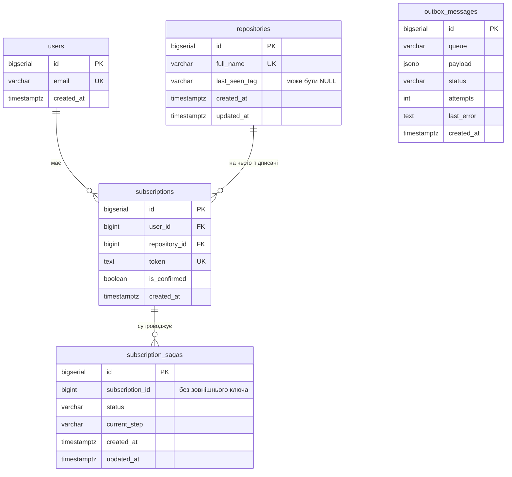
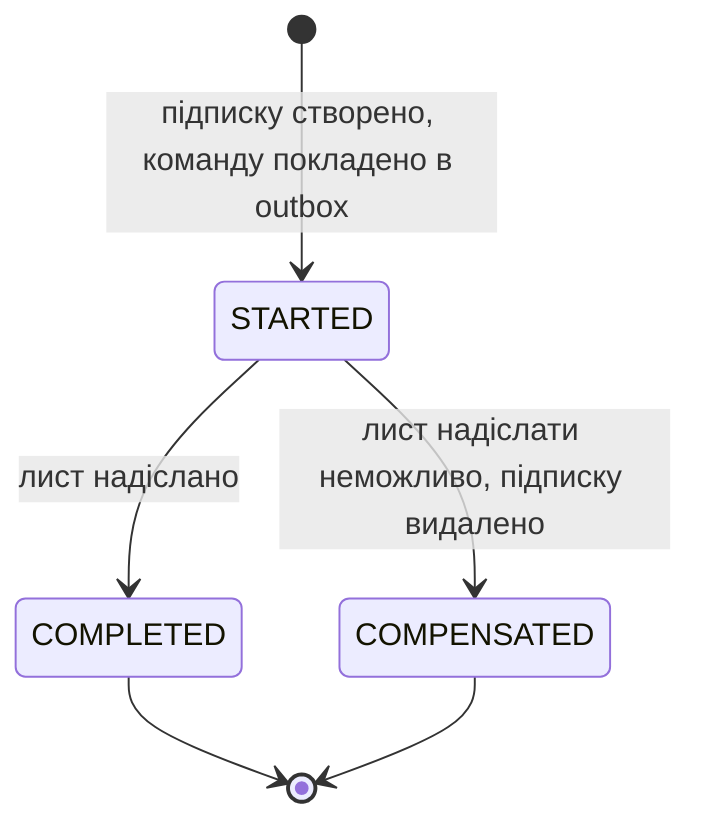
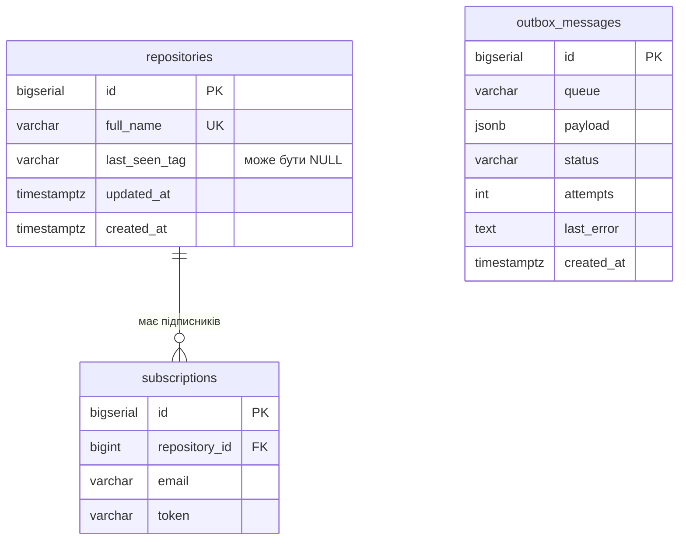

# Дані

Частина специфікації; короткий огляд і критерії прийняття — у [spec.md](../../spec.md).

## subscription_db

| Сутність | Призначення | Власник |
|---|---|---|
| `users` | адреси пошти | subscription |
| `repositories` | репозиторії, на які хтось підписувався, з копією останнього тегу для показу в списку | subscription |
| `subscriptions` | підписки з ознакою підтвердження і токеном | subscription |
| `subscription_sagas` | стан надсилання листа підтвердження | subscription |
| `outbox_messages` | повідомлення, що чекають публікації | subscription |

`subscription_sagas` не має зовнішнього ключа на `subscriptions` навмисно: після компенсації підписку видалено, а запис саги лишається як історія.

| Інваріант | Чим забезпечується |
|---|---|
| Одна адреса пошти — один користувач | `UNIQUE (email)` |
| Одна назва — один репозиторій | `UNIQUE (full_name)` |
| Користувач має не більше однієї підписки на репозиторій | `UNIQUE (user_id, repository_id)` |
| Токен унікальний у межах системи | `UNIQUE (token)`; токен — UUID |
| Підписка не існує без користувача та репозиторію | `ON DELETE CASCADE` на обох зовнішніх ключах |
| Нова підписка непідтверджена | сценарій підписки записує `is_confirmed = false` |

Стани саги:

Поле `current_step` має значення `SEND_CONFIRMATION`, доки сага в стані `STARTED`, і `ACTIVATE_SUBSCRIPTION` після переходу в `COMPLETED`.

Стани запису outbox: `PENDING` — чекає публікації; `FAILED` — вичерпано 5 спроб. Успішно опублікований запис видаляється.

## tracker_db

| Сутність | Призначення | Власник |
|---|---|---|
| `repositories` | репозиторії, за якими стежить сканер, і останній побачений тег | tracking |
| `subscriptions` | підписники репозиторію: кому надсилати лист про реліз | tracking |
| `outbox_messages` | повідомлення, що чекають публікації | tracking |

| Інваріант | Чим забезпечується |
|---|---|
| Одна назва — один репозиторій | `UNIQUE (full_name)` |
| Пошта є підписником репозиторію не більше одного разу | `UNIQUE (repository_id, email)` |
| Серед підписників лише підтверджені | запис з'являється тільки як реакція на `SubscriptionActivatedEvent` |
| Сканер опитує лише репозиторії, що мають підписників | запит вибирає репозиторії, для яких існує рядок у `subscriptions`; після відписки останнього підписника репозиторій видаляється |
| Підписник не існує без репозиторію | `ON DELETE CASCADE` |

## Дублювання між сервісами

| Дані | Джерело правди | Копія | Чим синхронізується | Допустиме відставання |
|---|---|---|---|---|
| Останній побачений тег | `tracker_db.repositories` | `subscription_db.repositories` | значення з відповіді `GetOrCreateRepository` під час підписки; подія `TagUpdatedEvent` після кожного релізу | інтервал ретранслятора плюс час у черзі; копія лише показується в списку підписок і на розсилку не впливає |
| Підтверджені підписки | `subscription_db.subscriptions` | `tracker_db.subscriptions` | події `SubscriptionActivatedEvent` і `UnsubscriptionActivatedEvent` | інтервал ретранслятора плюс час у черзі |
| Назва репозиторію | `tracker_db.repositories` | `subscription_db.repositories` | створюється під час підписки | немає: назва не змінюється |

`tracking` тримає власний список підписників, щоб під час релізу не звертатися до `subscription` по кожну адресу. Ціна — узгодженість у кінцевому підсумку: щойно підтверджена підписка може пропустити реліз, що вийшов до обробки події.
