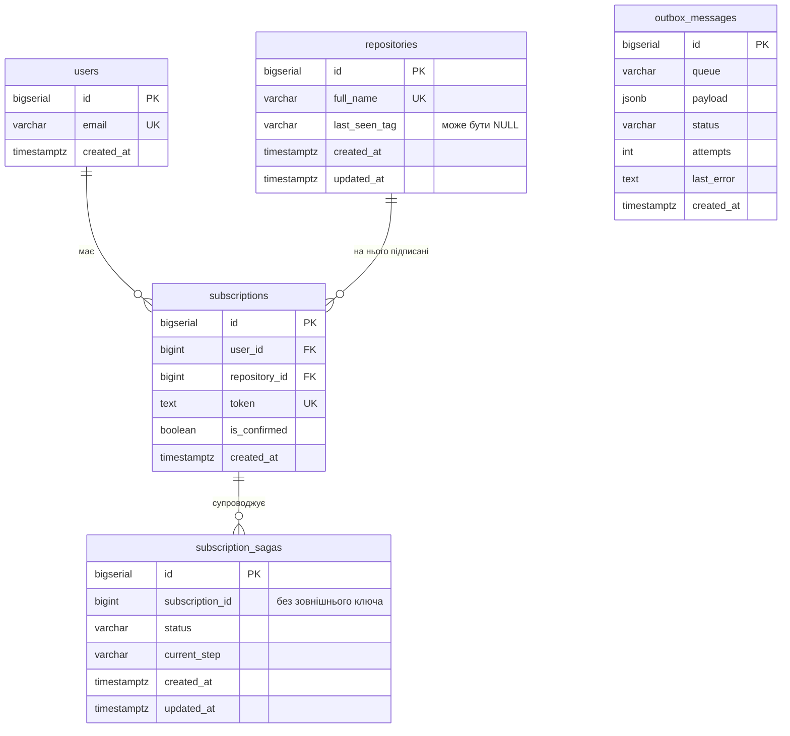
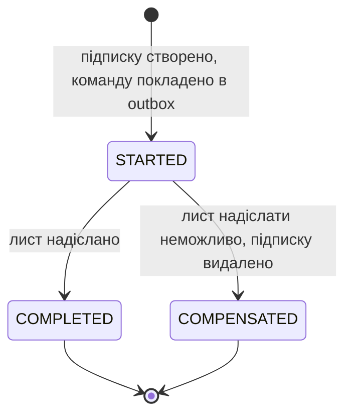
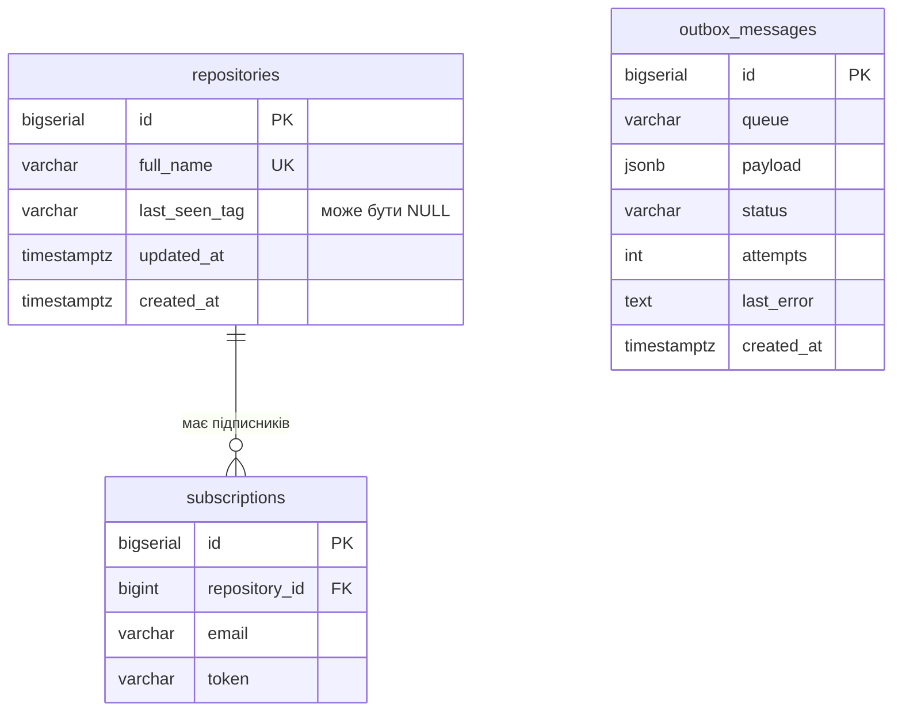

# Дані

Частина специфікації; короткий огляд і критерії прийняття — у [spec.md](../../spec.md).

## subscription_db



| Сутність             | Призначення                                                                          | Власник      |
| -------------------- | ------------------------------------------------------------------------------------ | ------------ |
| `users`              | адреси пошти                                                                         | subscription |
| `repositories`       | репозиторії, на які хтось підписувався, з копією останнього тегу для показу в списку | subscription |
| `subscriptions`      | підписки з ознакою підтвердження і токеном                                           | subscription |
| `subscription_sagas` | стан надсилання листа підтвердження                                                  | subscription |
| `outbox_messages`    | повідомлення, що чекають публікації                                                  | subscription |

`subscription_sagas` не має зовнішнього ключа на `subscriptions` навмисно: після компенсації підписку видалено, а запис саги лишається як історія.

| Інваріант | Чим забезпечується |
|---|---|
| Одна адреса пошти — один користувач | `UNIQUE (email)` |
| Одна назва — один репозиторій | `UNIQUE (full_name)` |
| Користувач має не більше однієї підписки на репозиторій | `UNIQUE (user_id, repository_id)` |
| Токен унікальний у межах системи | `UNIQUE (token)`; токен — UUID |
| Підписка не існує без користувача та репозиторію | `ON DELETE CASCADE` на обох зовнішніх ключах |
| Нова підписка непідтверджена | сценарій підписки записує `is_confirmed = false` |

Стани саги:



Поле `current_step` має значення `SEND_CONFIRMATION`, доки сага в стані `STARTED`, і `ACTIVATE_SUBSCRIPTION` після переходу в `COMPLETED`.

Стани запису outbox: `PENDING` — чекає публікації; `FAILED` — вичерпано 5 спроб. Успішно опублікований запис видаляється.

## tracker_db



| Сутність | Призначення | Власник |
|---|---|---|
| `repositories` | репозиторії, за якими стежить сканер, і останній побачений тег | tracking |
| `subscriptions` | підписники репозиторію: кому надсилати лист про реліз | tracking |
| `outbox_messages` | повідомлення, що чекають публікації | tracking |

| Інваріант | Чим забезпечується |
|---|---|
| Одна назва — один репозиторій | `UNIQUE (full_name)` |
| Пошта є підписником репозиторію не більше одного разу | `UNIQUE (repository_id, email)` |
| Серед підписників лише підтверджені | запис з'являється тільки як реакція на `SubscriptionActivatedEvent` |
| Сканер опитує лише репозиторії, що мають підписників | запит вибирає репозиторії, для яких існує рядок у `subscriptions`; після відписки останнього підписника репозиторій видаляється |
| Підписник не існує без репозиторію | `ON DELETE CASCADE` |

## Дублювання між сервісами

| Дані | Джерело правди | Копія | Чим синхронізується | Допустиме відставання |
|---|---|---|---|---|
| Останній побачений тег | `tracker_db.repositories` | `subscription_db.repositories` | значення з відповіді `GetOrCreateRepository` під час підписки; подія `TagUpdatedEvent` після кожного релізу | інтервал ретранслятора плюс час у черзі; копія лише показується в списку підписок і на розсилку не впливає |
| Підтверджені підписки | `subscription_db.subscriptions` | `tracker_db.subscriptions` | події `SubscriptionActivatedEvent` і `UnsubscriptionActivatedEvent` | інтервал ретранслятора плюс час у черзі |
| Назва репозиторію | `tracker_db.repositories` | `subscription_db.repositories` | створюється під час підписки | немає: назва не змінюється |

`tracking` тримає власний список підписників, щоб під час релізу не звертатися до `subscription` по кожну адресу. Ціна — узгодженість у кінцевому підсумку: щойно підтверджена підписка може пропустити реліз, що вийшов до обробки події.

## Схема

Початкові міграції кожного сервісу. Імена таблиць і стовпців — `snake_case`, час — `TIMESTAMPTZ`, ключі — `BIGSERIAL`.

### subscription_db

```sql
CREATE TABLE users (
    id         BIGSERIAL    PRIMARY KEY,
    email      VARCHAR(255) NOT NULL UNIQUE,
    created_at TIMESTAMPTZ  NOT NULL DEFAULT now()
);

CREATE TABLE repositories (
    id            BIGSERIAL    PRIMARY KEY,
    full_name     VARCHAR(255) NOT NULL UNIQUE,
    last_seen_tag VARCHAR(100),
    created_at    TIMESTAMPTZ  NOT NULL DEFAULT now(),
    updated_at    TIMESTAMPTZ  NOT NULL DEFAULT now()
);

CREATE TABLE subscriptions (
    id            BIGSERIAL   PRIMARY KEY,
    user_id       BIGINT      NOT NULL REFERENCES users (id) ON DELETE CASCADE,
    repository_id BIGINT      NOT NULL REFERENCES repositories (id) ON DELETE CASCADE,
    token         TEXT        NOT NULL UNIQUE,
    is_confirmed  BOOLEAN     NOT NULL DEFAULT FALSE,
    created_at    TIMESTAMPTZ NOT NULL DEFAULT now(),
    UNIQUE (user_id, repository_id)
);

CREATE INDEX idx_subscriptions_repository_id ON subscriptions (repository_id);

CREATE TABLE subscription_sagas (
    id              BIGSERIAL   PRIMARY KEY,
    subscription_id BIGINT      NOT NULL,
    status          VARCHAR(50) NOT NULL DEFAULT 'STARTED',
    current_step    VARCHAR(50) NOT NULL DEFAULT 'SEND_CONFIRMATION',
    created_at      TIMESTAMPTZ NOT NULL DEFAULT now(),
    updated_at      TIMESTAMPTZ NOT NULL DEFAULT now()
);

CREATE TABLE outbox_messages (
    id         BIGSERIAL    PRIMARY KEY,
    queue      VARCHAR(255) NOT NULL,
    payload    JSONB        NOT NULL,
    status     VARCHAR(20)  NOT NULL DEFAULT 'PENDING',
    attempts   INT          NOT NULL DEFAULT 0,
    last_error TEXT,
    created_at TIMESTAMPTZ  NOT NULL DEFAULT now()
);

CREATE INDEX idx_outbox_messages_status ON outbox_messages (status);
```

### tracker_db

```sql
CREATE TABLE repositories (
    id            BIGSERIAL    PRIMARY KEY,
    full_name     VARCHAR(255) NOT NULL UNIQUE,
    last_seen_tag VARCHAR(100),
    created_at    TIMESTAMPTZ  NOT NULL DEFAULT now(),
    updated_at    TIMESTAMPTZ  NOT NULL DEFAULT now()
);

CREATE TABLE subscriptions (
    id            BIGSERIAL    PRIMARY KEY,
    repository_id BIGINT       NOT NULL REFERENCES repositories (id) ON DELETE CASCADE,
    email         VARCHAR(255) NOT NULL,
    token         VARCHAR(255) NOT NULL,
    UNIQUE (repository_id, email)
);

CREATE TABLE outbox_messages (
    id         BIGSERIAL    PRIMARY KEY,
    queue      VARCHAR(255) NOT NULL,
    payload    JSONB        NOT NULL,
    status     VARCHAR(20)  NOT NULL DEFAULT 'PENDING',
    attempts   INT          NOT NULL DEFAULT 0,
    last_error TEXT,
    created_at TIMESTAMPTZ  NOT NULL DEFAULT now()
);

CREATE INDEX idx_outbox_messages_status ON outbox_messages (status);
```

### Індекси

| Запит | Яким індексом обслуговується |
|---|---|
| пошук користувача за поштою | `UNIQUE (email)` |
| пошук підписки за токеном | `UNIQUE (token)` |
| підписки користувача (`ListByEmail`) | `UNIQUE (user_id, repository_id)`: `user_id` — перший стовпець, окремий індекс не потрібен |
| підписки репозиторію | `idx_subscriptions_repository_id` |
| підписники репозиторію в `tracker_db` | `UNIQUE (repository_id, email)` |
| записи outbox до публікації | `idx_outbox_messages_status` |

Окремих індексів на `subscriptions (user_id)` і `subscriptions (token)` немає навмисно: їх уже дають унікальні обмеження, а дублікат індексу лише сповільнює запис.

Унікальні обмеження чутливі до регістру: пошта й назва репозиторію зберігаються так, як їх передав клієнт (див. [api.md](api.md)).

### Тестові дані

Інтеграційним тестам потрібні підписки з відомими токенами, бо листів, з яких токен можна взяти, у цьому завданні немає. Токен береться з бази поза кодом сервісу: тест читає його прямим запитом до `subscriptions`, а початкові дані закладає сід.

- Сід лежить окремо від міграцій схеми: `services/<сервіс>/migrations/testdata/`. Каталог міграцій лишається чистою схемою з цього документа, тож сід не потрапляє в прод.
- Сід застосовує лише тестовий харнес поверх звичайних міграцій.
- Прод-код токенів не показує й не логує.

