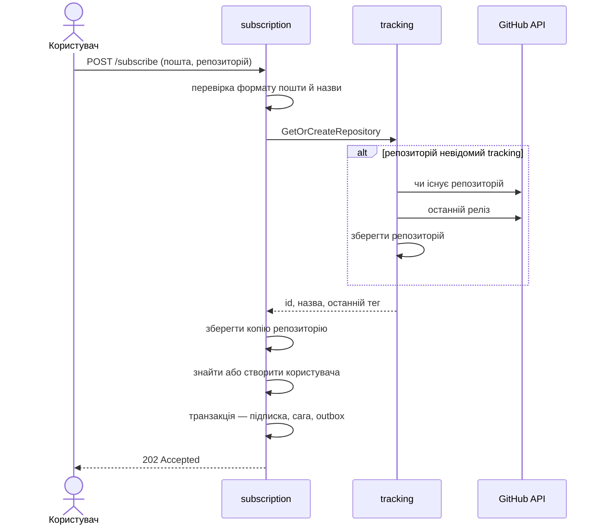
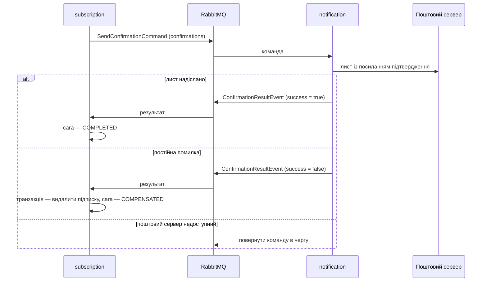
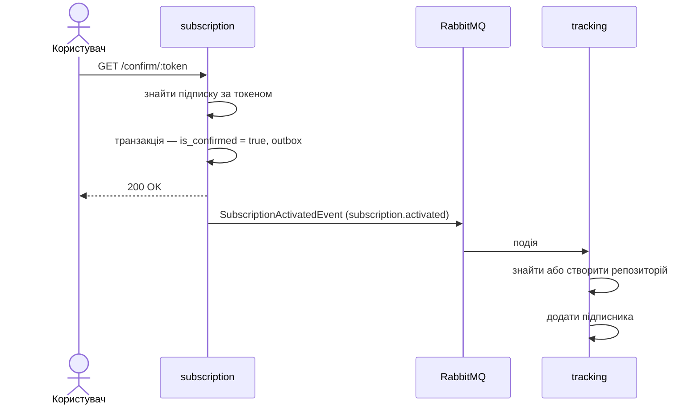
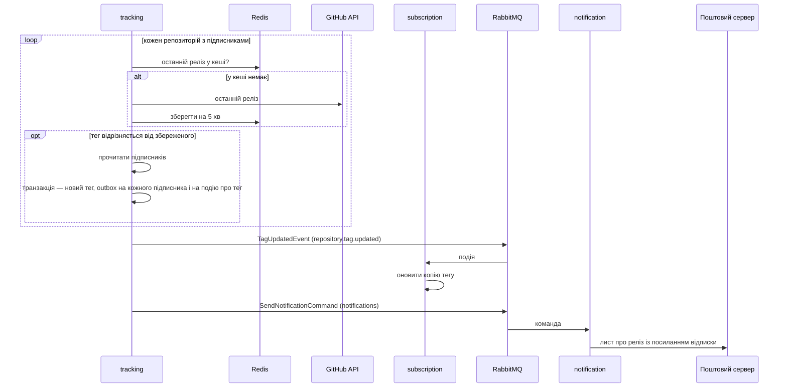
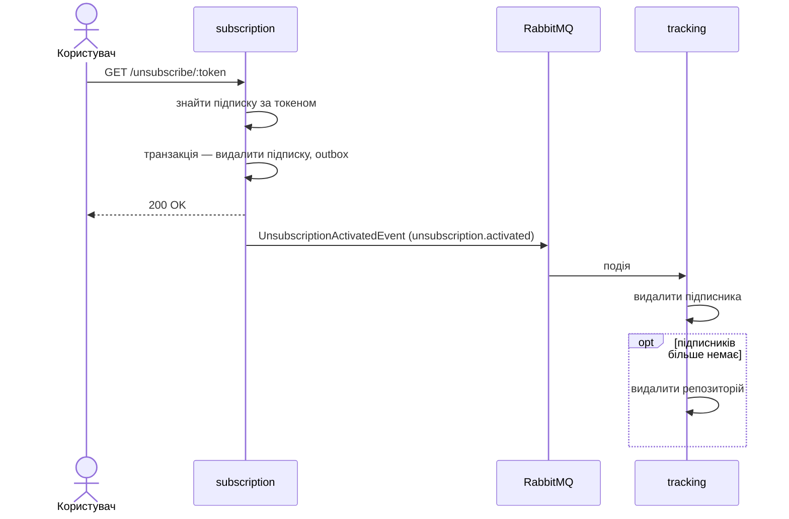

# Сценарії

Частина специфікації; короткий огляд і критерії прийняття — у [spec.md](../../spec.md).

Ідентифікатори `FR-n` і `NFR-n` посилаються на критерії прийняття в [spec.md](../../spec.md); дані описано в [data.md](data.md); відкриті питання — в [open-questions.md](open-questions.md).

## Спільний механізм: ретранслятор outbox

Працює в `subscription` і `tracking` однаково. Сценарії нижче посилаються на нього як на «ретранслятор».

За таймером, в одній транзакції:

| Крок | Таблиця | Операція |
|---|---|---|
| 1 | `outbox_messages` | вибрати до 100 записів `PENDING` за зростанням `id` з блокуванням `FOR UPDATE SKIP LOCKED` |
| 2 | — | опублікувати запис у чергу з назвою з поля `queue` і дочекатися підтвердження брокера |
| 3а | `outbox_messages` | якщо підтверджено — `DELETE` |
| 3б | `outbox_messages` | якщо ні — `attempts + 1`, записати `last_error`; на п'ятій спробі `status = FAILED` |

Блокування `SKIP LOCKED` дає змогу запускати кілька екземплярів сервісу: вони не беруть ті самі записи. Якщо сервіс упаде між кроками 2 і 3а, запис лишиться й буде опублікований удруге — звідси вимога NFR-2 до споживачів.

## SC-1. Підписка

- **Вимоги:** FR-1, FR-2, FR-3
- **Тригер:** `POST /api/v1/subscribe` з поштою та назвою репозиторію
- **Передумови:** запит містить ключ API

**Зміни даних**

| Крок | Сервіс | Таблиця | Операція | Транзакція |
|---|---|---|---|---|
| 1 | tracking | `repositories` | `INSERT` з назвою та поточним тегом, якщо репозиторію ще немає | T1 |
| 2 | subscription | `repositories` | `INSERT`, а якщо назва вже є — без змін | T2 |
| 3 | subscription | `users` | `INSERT`, якщо користувача з такою поштою немає | T3 |
| 4 | subscription | `subscriptions` | `INSERT` з новим токеном і `is_confirmed = false` | T4 |
| 5 | subscription | `subscription_sagas` | `INSERT` зі `status = STARTED`, `current_step = SEND_CONFIRMATION` | T4 |
| 6 | subscription | `outbox_messages` | `INSERT` команди `SendConfirmationCommand` для черги `confirmations` | T4 |

Кроки 4–6 фіксуються разом: або є підписка, сага і команда на лист, або немає нічого.

**Гілки збою**

| Де | Що сталося | Чим закінчується |
|---|---|---|
| перевірка формату | пошта чи назва не відповідає формату | `400` з переліком помилок; даних не змінено |
| крок 1 | репозиторію немає на GitHub | `404`; даних не змінено |
| крок 1 | GitHub недоступний або вичерпано ліміт запитів | `503`; даних не змінено |
| після кроку 1 | збій `subscription` | у `tracker_db` лишається репозиторій без підписників; сканер його не опитує |
| після кроку 3 | збій транзакції T4 | лишається користувач без підписок; повторний запит його знайде |
| крок 4 | підписка цієї пари вже існує | див. відкрите питання 1 |

## SC-2. Надсилання листа підтвердження

- **Вимоги:** FR-3
- **Тригер:** ретранслятор `subscription` публікує `SendConfirmationCommand`
- **Передумови:** виконано SC-1

**Зміни даних**

| Крок | Сервіс | Таблиця | Операція | Транзакція |
|---|---|---|---|---|
| 1 | subscription | `outbox_messages` | `DELETE` опублікованої команди | T1 |
| 2а | subscription | `subscription_sagas` | успіх: `status = COMPLETED`, `current_step = ACTIVATE_SUBSCRIPTION` | T2 |
| 2б | subscription | `subscriptions` | невдача: `DELETE` підписки | T3 |
| 3б | subscription | `subscription_sagas` | невдача: `status = COMPENSATED` | T3 |

`notification` даних не зберігає. Після успішного кроку 2а підписка лишається непідтвердженою: сага гарантує лише те, що лист надіслано. Підтвердження — окремий сценарій SC-3.

**Гілки збою**

| Де | Що сталося | Чим закінчується |
|---|---|---|
| `notification` | команда не розбирається | відхиляється без повтору; сага лишається `STARTED` |
| `notification` | поштовий сервер тимчасово недоступний | команда повертається в чергу й обробляється знову |
| `notification` | лист надіслано, але результат опублікувати не вдалося | команда повертається в чергу; користувач отримує лист удруге з тим самим токеном |
| крок 2а | результат доставлено вдруге | сага вже `COMPLETED`, крок пропускається |
| крок 2а або 2б | збій бази `subscription` | результат повертається в чергу |

## SC-3. Підтвердження підписки

- **Вимоги:** FR-4
- **Тригер:** `GET /api/v1/confirm/:token`
- **Передумови:** лист підтвердження надіслано

**Зміни даних**

| Крок | Сервіс | Таблиця | Операція | Транзакція |
|---|---|---|---|---|
| 1 | subscription | `subscriptions` | `UPDATE is_confirmed = true` | T1 |
| 2 | subscription | `outbox_messages` | `INSERT` події `SubscriptionActivatedEvent` | T1 |
| 3 | subscription | `outbox_messages` | `DELETE` після публікації | T2 |
| 4 | tracking | `repositories` | `INSERT`, якщо репозиторію вже немає | T3 |
| 5 | tracking | `subscriptions` | `INSERT` пошти й токена; якщо пара репозиторій–пошта вже є — оновити токен | T4 |

**Гілки збою**

| Де | Що сталося | Чим закінчується |
|---|---|---|
| пошук за токеном | токена немає | `404`; даних не змінено |
| T1 | збій бази | `500`; підписка лишається непідтвердженою, посилання можна відкрити знову |
| крок 4 | GitHub недоступний, а репозиторій треба створити заново | подія повертається в чергу |
| крок 5 | подію доставлено вдруге | запис уже є, оновлюється тим самим токеном; дубліката немає |
| між T1 і кроком 5 | вийшов реліз | цей підписник листа про нього не отримає |

## SC-4. Виявлення релізу та сповіщення

- **Вимоги:** FR-5, FR-6, FR-7
- **Тригер:** таймер сканера в `tracking`
- **Передумови:** є репозиторії з підписниками

**Зміни даних**

| Крок | Сервіс | Таблиця | Операція | Транзакція |
|---|---|---|---|---|
| 1 | tracking | `repositories` | `UPDATE last_seen_tag`, `updated_at` | T1 |
| 2 | tracking | `outbox_messages` | `INSERT` по одній команді `SendNotificationCommand` на підписника | T1 |
| 3 | tracking | `outbox_messages` | `INSERT` події `TagUpdatedEvent` | T1 |
| 4 | tracking | `outbox_messages` | `DELETE` кожного опублікованого запису | T2 |
| 5 | subscription | `repositories` | `UPDATE last_seen_tag` за назвою | T3 |

Кроки 1–3 фіксуються разом, тому реліз не може бути позначений побаченим без поставлених у чергу листів, і навпаки. Саме це не дає надіслати сповіщення двічі при наступному проході сканера.

**Гілки збою**

| Де | Що сталося | Чим закінчується |
|---|---|---|
| запит до GitHub | помилка, ліміт або перевищено 10 с | репозиторій пропускається; решта обробляється; наступний прохід спробує знову |
| репозиторій | релізів ще немає | змін немає |
| T1 | збій бази | тег не оновлено, команд немає; наступний прохід виявить реліз знову |
| крок 5 | `subscription` недоступний | подія чекає в черзі; розсилка не зупиняється; копія тегу оновиться, коли сервіс повернеться |
| крок 5 | подію доставлено вдруге | тег перезаписується тим самим значенням |
| `notification` | команда не розбирається | відхиляється без повтору |
| `notification` | лист надіслати не вдалося | команда повертається в чергу (відкрите питання 2) |
| між двома проходами | вийшло кілька релізів | надсилається один лист — про останній |

## SC-5. Перегляд підписок

- **Вимоги:** FR-8
- **Тригер:** `GET /api/v1/subscriptions?email=…`
- **Передумови:** запит містить ключ API

`subscription` читає `subscriptions`, з'єднані з `users` і `repositories`, за адресою пошти й повертає для кожної підписки назву репозиторію, ознаку підтвердження, останній відомий тег і час створення, від найновішої. Даних сценарій не змінює і до інших сервісів не звертається.

| Де | Що сталося | Чим закінчується |
|---|---|---|
| перевірка | пошта відсутня або не відповідає формату | `400` |
| читання | користувача або підписок немає | `200` з порожнім списком |
| читання | збій бази | `500` |

## SC-6. Відписка

- **Вимоги:** FR-7
- **Тригер:** `GET /api/v1/unsubscribe/:token`
- **Передумови:** підписка існує

**Зміни даних**

| Крок | Сервіс | Таблиця | Операція | Транзакція |
|---|---|---|---|---|
| 1 | subscription | `subscriptions` | `DELETE` | T1 |
| 2 | subscription | `outbox_messages` | `INSERT` події `UnsubscriptionActivatedEvent` | T1 |
| 3 | subscription | `outbox_messages` | `DELETE` після публікації | T2 |
| 4 | tracking | `subscriptions` | `DELETE` за поштою та назвою репозиторію | T3 |
| 5 | tracking | `repositories` | `DELETE`, якщо підписників не лишилося | T4 |

Рядок у `subscription_db.repositories` лишається: інші користувачі можуть бути підписані або підписатися пізніше.

**Гілки збою**

| Де | Що сталося | Чим закінчується |
|---|---|---|
| пошук за токеном | токена немає | `404`; даних не змінено |
| T1 | збій бази | `500`; підписка лишається, посилання можна відкрити знову |
| крок 4 | подію доставлено вдруге | видаляти нічого; помилки немає |
| між кроками 4 і 5 | збій `tracking` | подія повертається в чергу; крок 4 нічого не змінює, крок 5 виконується |
| між T1 і кроком 4 | вийшов реліз | користувач отримує ще один лист; посилання відписки в ньому вже недійсне |
