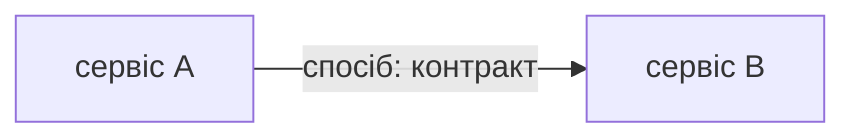
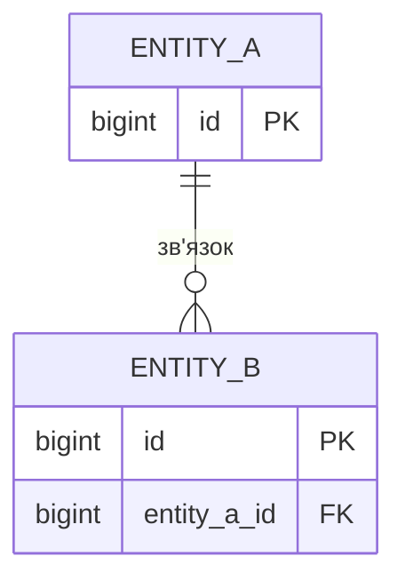
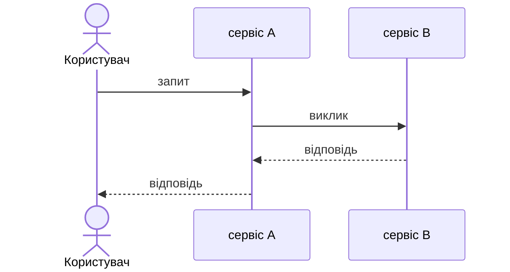

# Шаблони документів `docs/spec/`

Кожен блок нижче — заготовка для відповідного файла.

## components.md — компонент

### <назва сервісу>

| Поле | Зміст |
|---|---|
| Відповідальність | <одне речення> |
| Володіє даними | <таблиці> |
| Надає | <REST-шляхи, gRPC-методи, повідомлення> |
| Потребує | <чужі методи, повідомлення, зовнішні системи> |
| Чому окремо | <причина межі> |

## components.md — шари сервісу

| Шар | Тека | Може залежати від |
|---|---|---|
| <…> | <…> | <…> |

## components.md — взаємодія

| Звідки | Куди | Спосіб | Контракт | Гарантія | Що буде при збої |
|---|---|---|---|---|---|
| <…> | <…> | REST / gRPC / черга | <…> | <…> | <…> |

## components.md — відображення на структуру

| Компонент зі spec | Тека | Компонент у `.go-arch-lint.yml` |
|---|---|---|
| <…> | <…> | <…> |

## data.md — база

| Сутність | Призначення | Власник |
|---|---|---|
| <…> | <…> | <сервіс> |

| Інваріант | Чим забезпечується |
|---|---|
| <…> | <обмеження в базі / код> |

## data.md — дублювання між сервісами

| Дані | Джерело правди | Копія | Чим синхронізується | Допустиме відставання |
|---|---|---|---|---|
| <…> | <…> | <…> | <…> | <…> |

## scenarios.md — сценарій

### SC-n. <назва>

- **Вимоги:** FR-n
- **Тригер:** <…>
- **Передумови:** <…>

**Зміни даних**

| Крок | Сервіс | Таблиця | Операція | Транзакція |
|---|---|---|---|---|
| 1 | <…> | <…> | INSERT / UPDATE / DELETE | T1 |

**Гілки збою**

| Де | Що сталося | Чим закінчується |
|---|---|---|
| <крок> | <…> | <стан даних і відповідь користувачу> |

## open-questions.md

| № | Питання |
|---|---|
| 1 | <що не вирішено і які є варіанти> |
